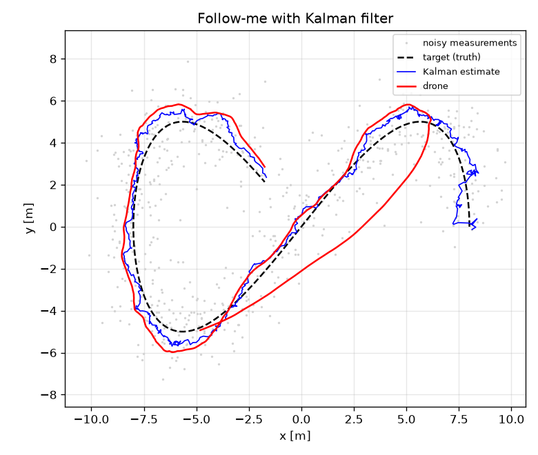

# Follow-Me Drone with Kalman Filter (2D simulation)

A target moves along a smooth 2D path; position measurements carry 1 m Gaussian noise.
A constant-velocity Kalman filter (state `[x, y, vx, vy]`) estimates position and velocity, and a
simulated drone follows using a P velocity controller (plus estimated target velocity feed-forward)
with a 4 m/s speed limit.

## Run
```
pip install numpy matplotlib pytest
python follow_me.py      # prints RMS errors, writes trajectory.png
python -m pytest -q      # drone RMS tracking error < 1.2 m, Kalman beats raw measurements
```

## Result


Typical RMS error (after the initial approach): raw measurements 1.39 m, Kalman estimate 0.50 m, drone vs. target 0.75 m.
