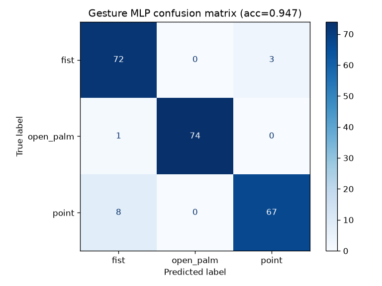

# Hand Gesture Classification (synthetic landmarks + MLP)

Generates synthetic 21-point hand landmarks (wrist + 4 joints per finger, the same layout used by common
hand-tracking libraries) for three gestures: `fist`, `open_palm`, `point`. Random rotation, scale,
per-finger extension noise and jitter are applied; landmarks are made wrist-relative. A scikit-learn
MLP (32-16 hidden units, standardised inputs) is trained and evaluated on a held-out split.

## Run
```
pip install numpy matplotlib scikit-learn pytest
python gesture_mlp.py    # prints test accuracy, writes confusion_matrix.png
python -m pytest -q      # asserts accuracy > 0.9
```

## Result


Test accuracy is printed by the script (about 0.95 with the default seed). Real camera landmarks would
replace `make_dataset`; the training and evaluation code stays the same.
