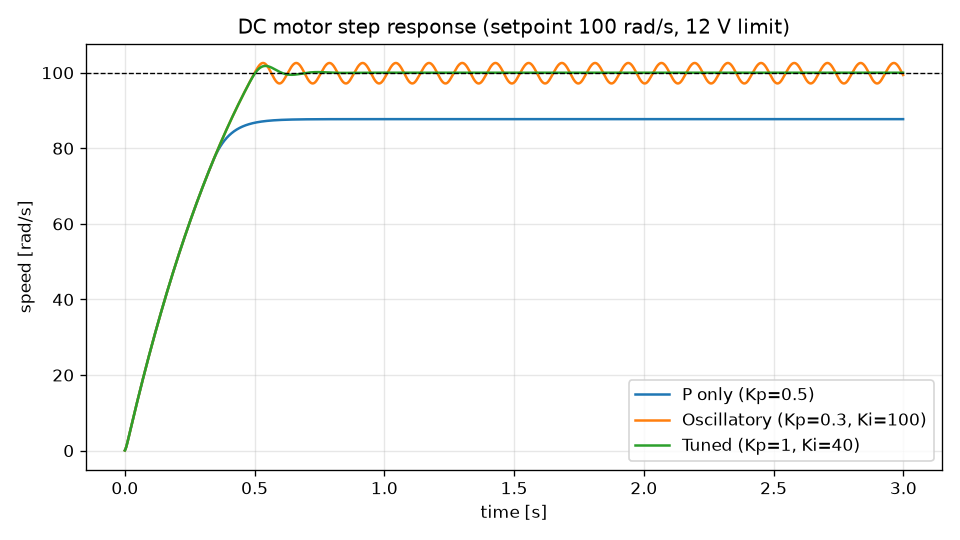

# PID DC Motor Simulation

Simulates a DC motor (electrical + mechanical model, 12 V supply limit) under speed control with a
discrete PID that uses clamping anti-windup. Compares three gain sets on a 100 rad/s step.

## Run
```
pip install numpy matplotlib pytest
python motor_pid.py      # prints overshoot / settling time, writes step_response.png
python -m pytest -q
```

## Result


| Gains | Overshoot | 2% settling |
|---|---|---|
| P only (Kp=0.5) | 0 % | never (steady-state error) |
| Oscillatory (Kp=0.3, Ki=100) | 2.6 % | ~3.0 s |
| Tuned (Kp=1, Ki=40) | 1.8 % | ~0.49 s |
